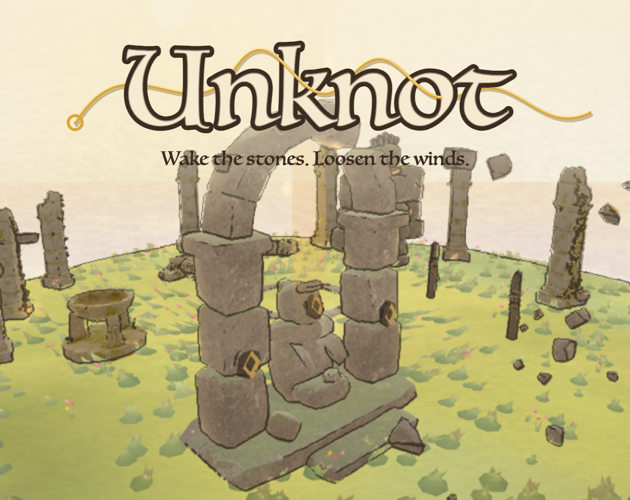

<p align="center"></p>

# Unknot

*RU: «Распутать»*

A quiet 3D puzzle-platformer in the browser. A cloaked wanderer crosses floating stone islands at dawn. The Keepers once sang a mountain into the sky, and its stones still carry their names. Strike runes, sing to the stones, ride the wind, and untie the knots that hold the mountain together. Three levels, a daily trial, a journal and a few secrets. English and Russian UI.

- Play on itch.io: https://rinekri.itch.io/unknot
- Play on GitHub Pages: https://rinekri.github.io/unknot/

## Controls

| Action | Keyboard / mouse | Gamepad |
|---|---|---|
| Move | WASD / arrows | left stick |
| Jump (hold = higher) | Space | A |
| Run | Shift | RB |
| Look | drag mouse | right stick |
| Strike with the staff | F or left click | X |
| Sing (hold, wakes a rune) | E | Y |
| Dash | Q or right click | B |
| Songs (once learned) | 1 / 2 / 3 | LB + X / Y / B |

## Build and run

Needs Node 22+.

```sh
cd engine
npm ci                    # also copies the Draco decoder to public/draco
npm run dev               # http://localhost:5173
npm run build -- --base ./   # static site in engine/dist (works from any subpath)
npm run preview           # http://localhost:4173
```

The runtime assets the game loads live in `engine/public/assets` (already optimized: meshopt + WebP GLBs, ogg audio) and are committed. The canonical, unoptimized sources are in `assets/`; `engine/tools/ship_assets.sh` is the sync-and-optimize step (it relies on a local helper script and `@gltf-transform/cli`, so it is only needed if you edit the sources). Levels are generated by `npm run gen-l1|gen-l2|gen-l3`; Blender scripts for the hero, props and enemies are in `engine/tools/*.py`. The 3 raw music masters (WAV, ~220 MB) are not in the repo.

## License

- Code: MIT, see [LICENSE](LICENSE).
- Art, audio, music, levels, text: CC BY-NC 4.0, see [LICENSE-ASSETS](LICENSE-ASSETS).
- Third-party: see [CREDITS.md](CREDITS.md) (three.js MIT, ambientCG Rock030 CC0).

## Making of

Unknot was built with Claude Code as a multi-agent pipeline: an Opus 5.5 coordinator, Fable 5.2 for the final passes, and Sonnet and Haiku helpers for implementation, checks and lookups.

- Timeline: 2026-11-13 to 2026-11-19 (7 days)
- About 105 sessions, roughly 1.68 B tokens (about 95% cache reads)
- API-equivalent cost: about $910

Pipeline in short:

1. A reference video sets the mood, which becomes a written art direction (`STYLE.md`, `GAME.md`).
2. The hero is built as a procedural Blender rig (`engine/tools/hero_*.py`), with props, NPCs and enemies from the same toolkit.
3. Levels are procedural: generator scripts (`engine/tools/gen_l*.mjs`) emit the world, colliders, mechanisms and Echo slots.
4. Bot playtests with three player profiles run against the build and report time, falls and dead ends.
5. The simulation is deterministic (fixed 60 Hz step, seeded RNG), so bot runs and regressions are reproducible.

---

## По-русски

«Распутать» (Unknot) — тихая 3D-головоломка-платформер в браузере: странник в плаще идёт по парящим каменным островам на рассвете, будит руны ударом посоха, поёт камням, ловит ветер и развязывает узлы, на которых держится гора. Играть: https://rinekri.itch.io/unknot или https://rinekri.github.io/unknot/.

Сборка: `cd engine && npm ci && npm run build -- --base ./`. Код под MIT, арт, звук и уровни под CC BY-NC 4.0. Игра сделана за 7 дней (13-19 ноября 2026) с помощью Claude Code: мультиагентный конвейер, около 105 сессий.
